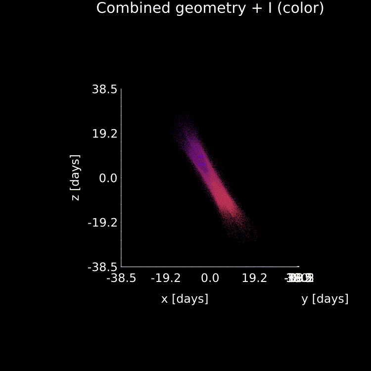

# BroadLineRegions.jl

A fast and flexible toolkit for modeling the broad-line region (BLR) in Julia.


## Installation 
### Julia
```julia
using Pkg
Pkg.add("BroadLineRegions")
```
Or install from the GitHub repo directly:
```julia
using Pkg
Pkg.add(url="https://github.com/kirklong/BroadLineRegions.jl")
```
### Python
To access `BroadLineRegions.jl` from within your Python installation, first you must install [`JuliaCall`](https://juliapy.github.io/PythonCall.jl/stable/juliacall/).
After successfully installing `JuliaCall` you can add `BroadLineRegions.jl` to your new Julia installation in Python with: 
```python
from juliacall import Main as jl
from juliacall import Pkg as jlPkg
jlPkg.add("BroadLineRegions") #or use the github link
```

## Quickstart 
While this code is designed to be very flexible and modular such that you can implement your own bespoke models of the BLR easier, two popular models of the BLR are included as default models which one can play with. 

To generate a "cloud" model similar to that of Pancoast+ 2011 and 2014, use syntax like:
```julia
using BroadLineRegions #exports itself as both BroadLineRegions and the shorter acronym BLR
mClouds = BLR.cloudModel(100_000,μ=500.,β=1.,F=0.5,θₒ=30/180*π,γ=1.,ξ=1.,i=0.,
        I=BLR.IsotropicIntensity,v=BLR.vCircularCloud,rescale=1e-5,τ=0.0)
```

To generate a "disk-wind" model similar to that of Chiang and Murray 1996 and 1997 following the prescription laid out in Long+ 2023 and 2025 use syntax like:
```julia
mDisk = BLR.DiskWindModel(500.,5.,1.,30/180*π,nr=24,nϕ=48,scale=:log,
        f1=1.0,f2=1.0,f3=1.0,f4=1.0,reflect=false,τ=5.)
```

In case you do not like unicode symbols, spelled out keyword aliases (for example `mu`, `theta_o`, and `tau`) are also available for all parameters (and can be mixed and matched with the unicode symbols), i.e. for the cloud model example above we could also write:
```julia
mClouds = BLR.cloudModel(100_000,mu=500.,beta=1.,F=0.5,theta_o=30/180*pi,gamma=1.,xi=1.,i=0.,
        I=BLR.IsotropicIntensity,v=BLR.vCircularCloud,rescale=1e-5,tau=0.0)
```
See each function's documentation (either online or in the REPL with i.e. `?BLR.cloudModel`) for a list of all parameters, their defaults, and available spelled out ASCII keyword aliases. 
Note that the internal code still uses largely unicode names, so to access struct fields only the unicode versions are supported (i.e. only `m.camera.α` works, and `m.camera.alpha` will produce an error). 
You can of course define fully custom models by passing your own "rings" (on a camera) and optionally any default profiles, a camera struct, and submodel start indices:

```julia
mCustom = BLR.model(myCustomRings,nothing,myCustomCamera,[1]) #a custom model with no profiles, a user-defined camera for raytracing/visualization, and with no submodels
```
And you can also define your own custom functions as overrides to the defaults used in any of the existing `BroadLineRegions.jl` models:
```julia
myIntensityFx(; r, level=1.0, kwargs...) = level/r #a simple custom intensity scaling like 1/r 
mCustomDisk = BLR.DiskWindModel(500.,5.,1.,30/180*π,n4=24,n_phi=48,scale=:log,
        I=myIntensityFx,level=2.) #instead of using default DiskWindIntensity use custom myIntensityFx with level=2.
```
Note that `BroadLineRegions.jl` attempts to make sure you have correctly passed keyword arguments for functions, and will issue a warning if it detects 
a keyword argument that it does not know how to check. This warning would be issued in the above case, as `level` is not a parameter of any existing function. 
For custom callbacks, you can thus optionally register extra keywords to enable stricter validation and suppress this warning:
```julia
myIntensityFx(; r, level=1.0, kwargs...) = level/r #a simple custom intensity scaling like 1/r 
BLR.acceptedKeywords(::typeof(myIntensity)) = (:level,)
```

Models can be combined simply by writing `mCombined = m1 + m2`. 

Generate profiles (i.e. line, phase, delay, or whatever else your heart desires) for models with syntax like:
```julia
m = mDisk #or mClouds, mCustom, or however you have set up your model
p = BLR.getProfile(m,:line) #generate line profile with default parameters
BLR.setProfile!(m,p) #optinally store the profile in model data structure 
```

A few default visualization recipes exist as well:
```julia
profiles = BLR.profile(m) #plot all of the model's stored profiles 
img = BLR.image(m,:I) #make an image of the model intensity, can pass any other parameter as well to "image" them
geometry = BLR.plot3d(m) #visualize the geometry of the system in a 3d plot, can also color points according to any parameter
```

Note that no functions are exported by default into the global namespace to prevent overlap with other modules, and you must prepend the module name to all methods to access them. `BroadLineRegions.jl` exports itself as both `BroadLineRegions` and `BLR`, so both of these prefixes are equivalent, i.e. `BroadLineRegions.model == BLR.model`. If adding this prefix annoys you, you can avoid this by specifying the functions you want added to the global namespace in your `import`/`Using` statement. For example:

```julia
using BLR: DiskWindModel, cloudModel
mDisk = DiskWindModel(parms...) #instead of BLR.DiskWindModel
```

For more detailed examples, see the [Usage and Examples](@ref) page.

Full documentation is available in the [API](@ref) section.

Also note that if you are using `BroadLineRegions` from within Python you will need to modify all the code examples with the corresponding name that you imported julia with, i.e. the simple cloud example in the quickstart above in Python would become: 

```python
from juliacall import Main as jl
import numpy as np
jl.seval("Using BroadLineRegions") #load BLR into Main

mClouds = jl.BLR.cloudModel(100_000,μ=500.,β=1.,F=0.5,θₒ=30/180*np.pi,γ=1.,ξ=1.,i=0.,
             I=jl.BLR.IsotropicIntensity,v=jl.BLR.vCircularCloud,rescale=1e-5,τ=0.0)
```

You may also consider starting Julia with a `sysimage` to improve performance (see pure Julia example [here](https://julialang.github.io/PackageCompiler.jl/dev/sysimages.html), and instructions for enabling the functionality in `juliacall` [here](https://juliapy.github.io/PythonCall.jl/stable/juliacall/#julia-config)).

## Referencing
If you find this code useful in your work, please cite it as:
```bibtex
lorem ipsum
```

## Contributing
If you would like to contribute to the package, please open a pull request on the [GitHub](https://github.com/kirklong/BroadLineRegions.jl). For bug reports and feature requests, please open an issue on the GitHub. 